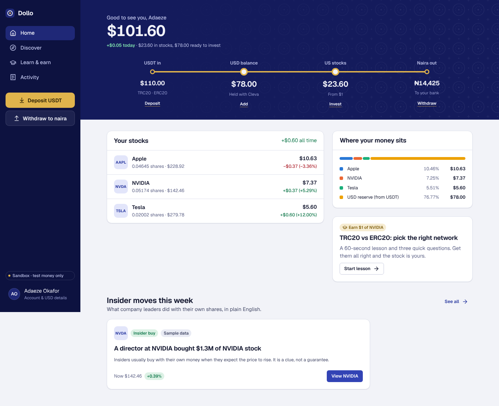
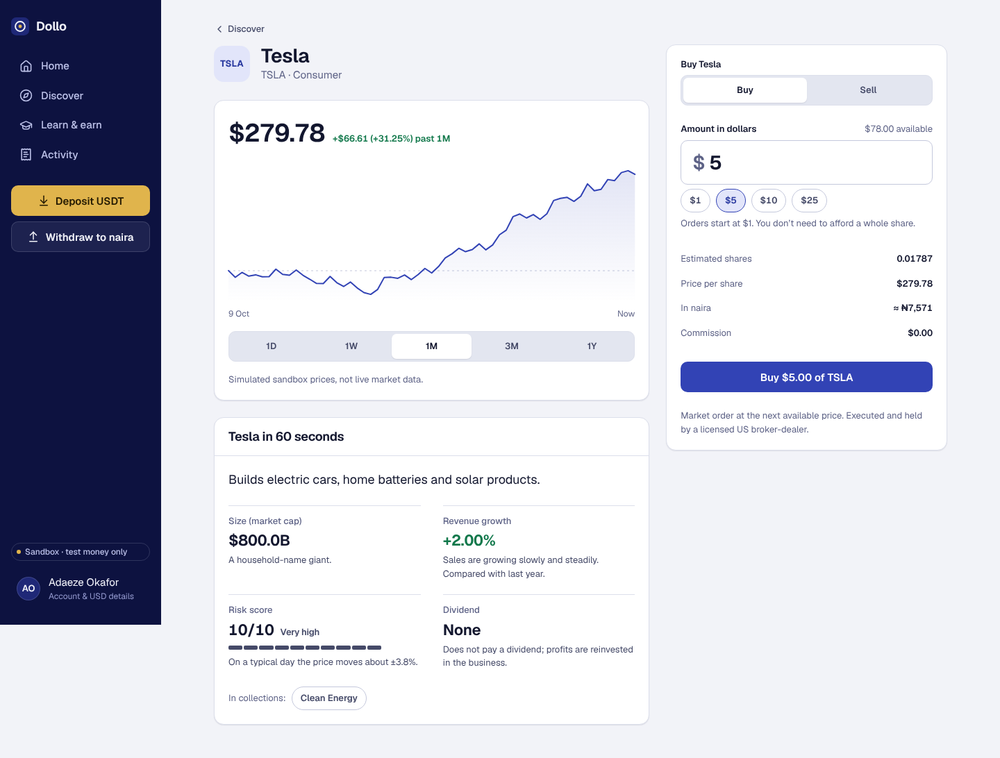
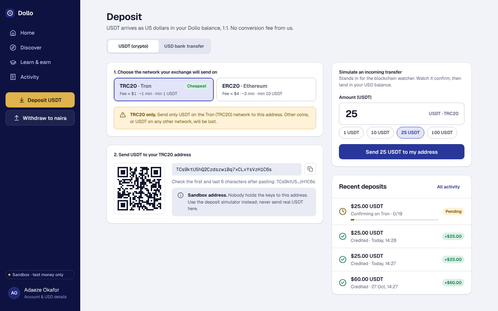
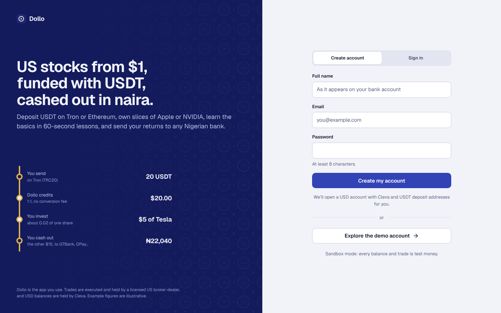

# Dollo

**US stocks from $1, funded with USDT, cashed out in naira.**

Dollo is a mobile-first investing app for Nigerian retail investors. Users deposit USDT (Tron or Ethereum), which lands in a Cleva USD balance 1:1. They read plain-English market intelligence, buy fractional US shares from $1, learn the basics in 60-second lessons that pay out $1 stock rewards, and withdraw returns to any Nigerian bank in naira.

Everything runs in **sandbox mode** by default. No real money moves, and every simulated surface is labelled as such in the UI.

## Run it

Requires Node 20+.

```bash
npm install
```

```bash
npm run build && npm start
```

Open http://localhost:4000 and choose **Explore the demo account**. It opens a lived-in account: 60 USDT deposited, three stock positions, one completed lesson and one naira withdrawal.

For development, with hot reload on the frontend (Vite on :5173 proxies `/api` to :4000):

```bash
npm run dev
```

Run the API tests (14 tests covering the whole money flow):

```bash
npm test
```

## Modules

| Module | What ships |
| --- | --- |
| **1. Wallet & rails** | Per-user TRC20 and ERC20 USDT deposit addresses (valid formats, sandbox-only). The UI shows network warnings, a QR code, minimums and live confirmations. Deposits credit USD 1:1. Each user gets a Cleva USD account (account and routing details). Naira withdrawal flow: quote, 1% fee (min $0.50), NUBAN name enquiry across 13 banks and fintechs, payout status. |
| **2. Market intelligence** | Insider buys and sells rewritten in plain English with what they mean. Sector collections (AI Revolution, Top Dividend Payers, Clean Energy, Brands You Already Use). A "company in 60 seconds" snapshot: market cap, revenue growth, a 1–10 risk score and dividends, each with a plain-language sentence. Search across all of it. |
| **3. Fractional execution** | $1-minimum dollar-amount buy and sell (and sell-all) orders, micro-share precision, a price chart with scrubbing over 1D–1Y, and a portfolio with P/L, day change and allocation across stocks and the USD reserve. |
| **4. Learn-to-earn** | Five 60-second lessons (stablecoins, TRC20 vs ERC20, fractional shares, reading a company, insider signals). Each has three quick cards and a three-question quiz with instant feedback. A perfect score grants $1 of a named stock, once per lesson, checked on the server. |

The signature UI element is the **money route** on Home. It draws the user's money as a transit line from *USDT in* to *USD balance* to *US stocks* to *Naira out*, with live amounts at each stop. The first segment animates while a deposit is confirming.

## Architecture

```
React (Vite, TS) mobile-first web app
            │  /api (JSON, bearer token)
            ▼
Node / Express API  (backend/src)
 ├── services/ledger.js   deposits · orders · rewards · withdrawals · portfolio
 ├── services/market.js   quotes · snapshots · collections · search
 ├── seed/courses.js      Learn-to-earn content (answers never leave the server)
 └── providers/
      ├── cleva.js        USD account issuance, NUBAN name enquiry, NGN payouts   (sandbox)
      ├── tether.js       TRC20/ERC20 address generation, deposit networks       (sandbox)
      ├── alpaca.js       quotes + notional orders, Alpaca paper API      (live with keys)
      ├── fmp.js          insider filings, Financial Modeling Prep        (live with key)
      └── fx.js           indicative USD/NGN rate + withdrawal fee
```

- Money is stored as integer cents and shares as integer micro-shares, so there is no float drift in balances.
- Persistence is a JSON file (`backend/data/db.json`), written atomically. Set `DB_FILE=:memory:` to skip disk.
- Sandbox deposits and payouts settle on a timer (`DEPOSIT_DELAY_MS`, `PAYOUT_DELAY_MS`), standing in for a blockchain watcher and a payout webhook.
- Simulated prices are a deterministic random walk per symbol (`lib/prices.js`), so every client sees the same tape.

### Going live, provider by provider

Copy `.env.example` to `.env` (or export the variables) and fill in what you have. Each provider switches on independently. `GET /api/health` and the Account screen show which are live.

- **Alpaca:** set `ALPACA_KEY_ID` and `ALPACA_SECRET_KEY`. Quotes then come from Alpaca market data, and orders route to the Alpaca **paper** trading API as notional market orders. In production this becomes the Alpaca Broker API, with one account per user.
- **Financial Modeling Prep:** set `FMP_API_KEY`. The insider feed then uses the latest Form 4 filings for covered symbols, and falls back to the labelled sample feed on any error.
- **Cleva / Tether:** the adapters are faithful in shape (create account, resolve account, start payout; address per network). Replace the function bodies once production API access and docs are available. Nothing else in the backend changes.

> Sandbox deposit addresses have no private keys. They are for demonstration only and the UI says so next to every address.

## API

All routes are under `/api`. Routes marked 🔒 need `Authorization: Bearer <token>`.

| Method & path | Purpose |
| --- | --- |
| `POST /auth/signup` · `POST /auth/login` · `POST /auth/demo` | Returns `{ token, user }`. Signup issues a Cleva USD account and USDT addresses. |
| 🔒 `GET /auth/me` · `POST /auth/logout` | Session |
| 🔒 `GET /wallet` | USD balance, Cleva account, USDT addresses, recent deposits with confirmations |
| 🔒 `POST /deposits/simulate` `{ network, amount }` | Sandbox stand-in for an incoming USDT transfer |
| `GET /networks` · `GET /fx` · `GET /banks` | Network rules, USD/NGN rate, bank list |
| 🔒 `POST /banks/resolve` `{ bankCode, accountNumber }` | NUBAN name enquiry |
| 🔒 `GET /withdrawals/quote?amount=` · `POST /withdrawals` · `GET /withdrawals/:id` | USD to NGN payout |
| `GET /market/feed` · `/market/collections` · `/market/collections/:id` · `/market/search?q=` · `/market/stocks/:symbol?range=1D\|1W\|1M\|3M\|1Y` | Market intelligence |
| 🔒 `POST /orders` `{ symbol, side, amount }` or `{ symbol, side: "sell", all: true }` · `GET /orders` | Fractional orders, $1 minimum |
| 🔒 `GET /portfolio` | Holdings, P/L, allocation, money-route totals |
| 🔒 `GET /learn/courses` · `GET /learn/courses/:id` · `POST /learn/courses/:id/check` · `POST /learn/courses/:id/submit` | Learn-to-earn |
| 🔒 `GET /activity` | Unified ledger |

Errors are always `{ error: { code, message } }`, and each message tells the user how to recover.

## Hackathon defence notes

- **Regulatory and custody:** Dollo is the UX, education and order-routing layer. Execution and custody sit with a licensed US broker-dealer (Alpaca). USD balances and naira payouts sit with Cleva. The app says this on the welcome screen, the trade panel and the Account screen.
- **Web3 onboarding:** the network choice is a two-option picker with fees, arrival times and minimums ($1 on TRC20, $10 on ERC20). A warning names the one network that address accepts. A lesson teaches the TRC20/ERC20 rule and pays $1 for passing.
- **Demo flow for Saturday (about 3 minutes):** Explore the demo account → Deposit → simulate 25 USDT on TRC20 (watch the confirmations and the money route animate) → Discover → open Tesla from an insider-buy card → buy $5 → Learn → pass "TRC20 vs ERC20" to earn $1 of NVIDIA → Withdraw $10 to GTBank → Activity.

## Design

The UI follows the [impeccable](https://github.com/pbakaus/impeccable) design guidance in Operate mode: standard controls, a restrained product palette, and one signature move. See [DESIGN.md](DESIGN.md) for tokens, the validated chart palette and component rules, and [PRODUCT.md](PRODUCT.md) for product context.

## Screenshots

| Home (money route) | Stock + $1 trade |
| --- | --- |
|  |  |
| **USDT deposit** | **Welcome** |
|  |  |
